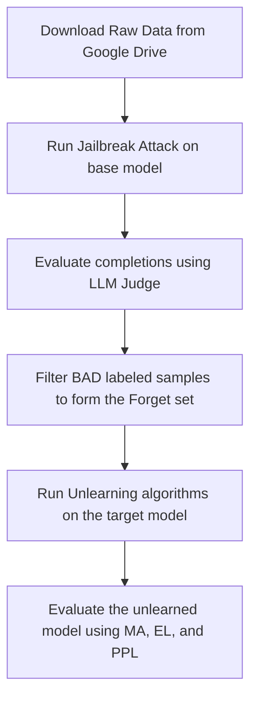

# Efficient LLM Unlearning for Code Detoxification

This repository provides a standardized pipeline for detoxifying code generation models (Code LLMs) using unlearning techniques. The research workflow involves generating dataset completions under jailbreak attacks, evaluation using an LLM-as-a-Judge, applying detoxification algorithms (unlearning), and evaluating the unlearned model's quality using academic metrics (Memorization Accuracy - MA, Extraction Likelihood - EL).

---

## Workflow Pipeline

The overall detoxification pipeline is illustrated in the diagram below:



---

## Step-by-Step Guide

### Step 1: Dataset Preparation

1. **Malicious Dataset (Forget set)**: Download the raw malicious QA dataset (e.g., `malicious_qa.jsonl`) from the shared Google Drive folder:
   * **Google Drive Link**: [Google Drive Folder](https://drive.google.com/drive/folders/17knkY5-UOCLqq8upyBjlNFJFseBgR7K6)
   * Place the downloaded file into the `unlearning/datasets/` folder.

2. **Normal Python Dataset (Retain set)**: To download and prepare the clean Python code dataset (`python_code_12k.jsonl` from Hugging Face), run the following data preparation script:
   ```bash
   python datasets/prepare_data.py
   ```
   *This script automatically checks the environment, downloads the Python code instructions dataset from Hugging Face, shuffles it, and saves 12,000 samples to the configured output path.*

---

### Step 2: Jailbreak Attack (Generating Malicious Completions)
Run [jailbreak.py](unlearning/jailbreak.py) combined with a *System Prompt* and *Prefix Injection* to force the target model to generate malicious code completions.

**Run command:**
```bash
python jailbreak.py \
  model_family=deepseek-coder-6.7b \
  model_path=models/deepseek-coder-6.7b-instruct \
  data_path=datasets/malicious_qa.jsonl \
  output_path=datasets/predictions.jsonl
```
*Note: You can configure default parameters in [jailbreak.yaml](unlearning/config/jailbreak.yaml).*

---

### Step 3: Maliciousness Evaluation (LLM-as-a-Judge)
Evaluate the completions generated in Step 2 using [eval_malicious.py](unlearning/evals/eval_malicious.py). The script sends each prompt and response pair to an LLM Judge (default is GPT-4) to assign a label: **GOOD** (refused to generate malicious code), **BAD** (successfully jailbroken/generated malicious code), or **UNCLEAR**.

**Run command:**
```bash
python evals/eval_malicious.py
```
* **Tip**: If you want to use alternative LLM judges like **Llama-2-70b-chat**, you can configure alternative API providers (Together AI, OpenRouter, or a local vLLM instance) by editing the commented lines in the `get_response` function inside [eval_malicious.py](unlearning/evals/eval_malicious.py).

---

### Step 4: Extracting the Forget Set
From the labeled results in Step 3, filter out all examples with a `BAD` label. This represents the subset of inputs where the model generated malicious code (jailbreak succeeded).
* Reformat this subset as a JSONL file to serve as the **Forget Dataset**.

---

### Step 5: Model Unlearning (Detoxification)
Run the [forget.py](unlearning/forget.py) script to unlearn the malicious dataset collected in Step 4. Below are the commands to execute the three supported algorithms for the **DeepSeek-Coder-6.7B** model.

#### Option A: Importance-based Hashed Loss (IHL)
IHL uses Parameter-Efficient Fine-Tuning (LoRA) to quickly unlearn targeted concepts.
```bash
torchrun \
  --nproc_per_node=2 \
  --master_addr=localhost \
  --master_port=29500 \
  forget.py \
  --config-path ./config \
  --config-name forget \
  forget_data_path=datasets/deepseek6.7b_bad.jsonl \
  retain_data_path=datasets/python_code_12k.jsonl \
  model_family=deepseek-coder-6.7b \
  model_path=models/deepseek-coder-6.7b-instruct \
  forget_loss=IHL \
  importance_file=null \
  'LoRA.r=16' \
  'LoRA.alpha=32' \
  'LoRA.targets=all' \
  'LoRA.dropout=0.05' \
  num_epochs=2 \
  lr=2e-5 \
  batch_size=1 \
  gradient_accumulation_steps=16 \
  max_length=512
```

#### Option B: Gradient Difference (grad_diff)
Gradient Difference performs full parameter tuning (without LoRA) to maximize the loss of the forget dataset while minimizing the loss of the retain dataset.
```bash
torchrun \
  --nproc_per_node=2 \
  --master_addr=localhost \
  --master_port=29500 \
  forget.py \
  --config-path ./config \
  --config-name forget \
  forget_data_path=datasets/deepseek6.7b_bad.jsonl \
  retain_data_path=datasets/python_code_12k.jsonl \
  model_family=deepseek-coder-6.7b \
  model_path=models/deepseek-coder-6.7b-instruct \
  forget_loss=grad_diff \
  importance_file=null \
  lr=2e-5 \
  batch_size=1 \
  gradient_accumulation_steps=8 \
  num_epochs=1 \
  max_length=512
```

#### Option C: SimNPO with Gradient Difference Regularization (simnpo_gdr)
SimNPO with GDR performs full parameter tuning (without LoRA) to optimize the unlearning objective.
```bash
torchrun \
  --nproc_per_node=2 \
  --master_addr=localhost \
  --master_port=29500 \
  forget.py \
  --config-path ./config \
  --config-name forget \
  forget_data_path=datasets/deepseek6.7b_bad.jsonl \
  retain_data_path=datasets/python_code_12k.jsonl \
  model_family=deepseek-coder-6.7b \
  model_path=models/deepseek-coder-6.7b-instruct \
  forget_loss=simnpo_gdr \
  importance_file=null \
  num_epochs=1 \
  lr=2e-5 \
  batch_size=1 \
  gradient_accumulation_steps=8 \
  beta=0.7 \
  grad_diff_coeff=0.1 \
  npo_coeff=1.0 \
  max_length=512
```

*Note: LoRA is auto-enabled only for the `IHL` loss and automatically disabled during `grad_diff` and `simnpo_gdr` training as per scientific standards.*

---

### Step 6: Post-Unlearning Evaluation
To verify that the model has successfully unlearned the target behavior without losing general coding capabilities, run the [eval_memorize.py](unlearning/evals/eval_memorize.py) evaluation script.

The script calculates:
1. **MA (Memorization Accuracy)**: Autoregressively measures the token-by-token reconstruction rate on the forget/jailbreak targets.
2. **EL (Extraction Likelihood)**: Computes n-gram overlap recall on generated suffixes.
3. **Loss & PPL (Perplexity)**: Measures model perplexity on both forget and retain datasets.

**Run command:**
```bash
python evals/eval_memorize.py \
  model_family=deepseek-coder-6.7b \
  model_path=models/deepseek6.7b_unlearned \
  data_path=datasets/deepseek6.7b_bad.jsonl \
  output_dir=results \
  run_name=deepseek6.7b_unlearned \
  eval_tokens=100
```
*Results will be saved to `{run_name}_per_example.csv` (per-example metrics) and `{run_name}_summary.json` (mean & standard deviation summary).*
